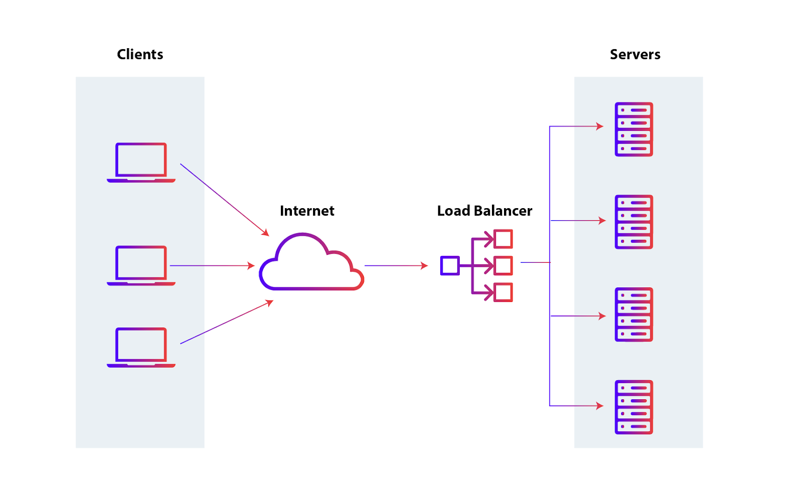

# Load Balancing

---

Load balancing é a técnica de distribuir requisições ou conexões entre múltiplos servidores para melhorar a escalabilidade, a disponibilidade e o uso dos recursos de um sistema.

Em vez de direcionar todo o tráfego para um único servidor, um load balancer distribui a carga entre diferentes instâncias.

## Objetivos

- **Escalabilidade:** distribuir o tráfego entre múltiplas instâncias.
- **Disponibilidade:** evitar que a falha de uma instância indisponibilize todo o serviço.
- **Distribuição de carga:** evitar sobrecarregar servidores específicos.
- **Desempenho:** aproveitar melhor os recursos disponíveis.
- **Flexibilidade:** permitir adicionar ou remover instâncias conforme a demanda.

## Quando utilizar

O load balancing é especialmente relevante quando:

- Uma única instância não suporta o volume de requisições.
- É necessário executar múltiplas instâncias de uma aplicação.
- O sistema precisa continuar operando mesmo com a falha de um servidor.
- A demanda varia e exige escalabilidade horizontal.
- Existem servidores distribuídos em diferentes regiões geográficas.

## Conteúdo

- [Conceitos](./2.1-concepts.md)
- [Algoritmos de distribuição](./2.2-algorithms.md)
- [Health checks e recuperação](./2.3-health.md)
- [Arquiteturas de load balancing](./2.4-architectures.md)

---

[← Redes e comunicação](../02-networking/2.0-networks.md)

[Conceitos →](./2.1-concepts.md)

