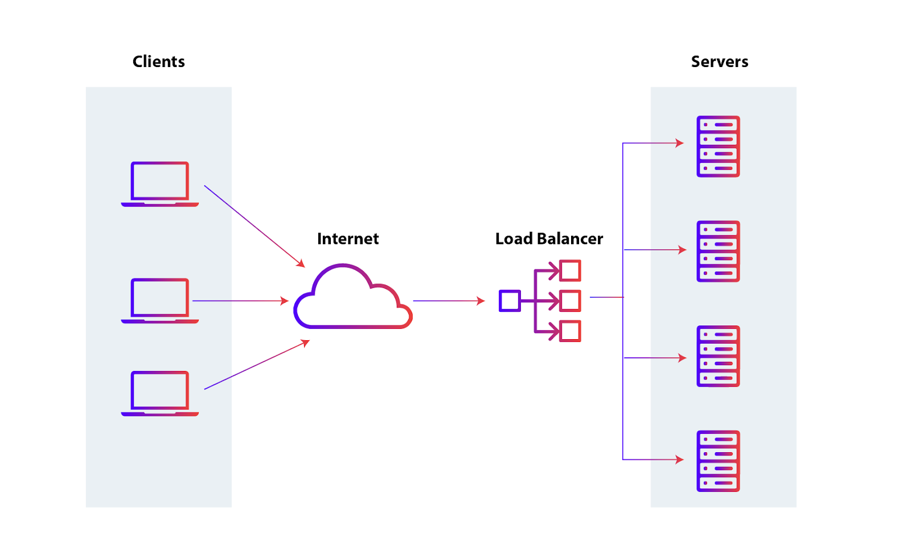
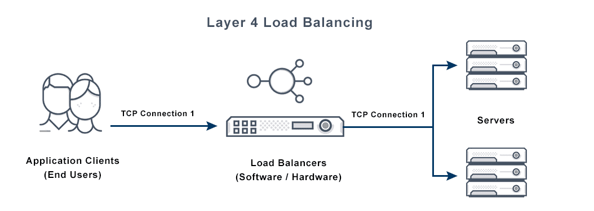
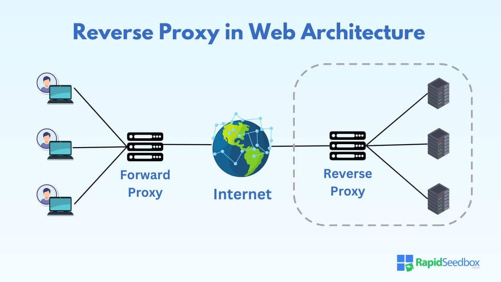
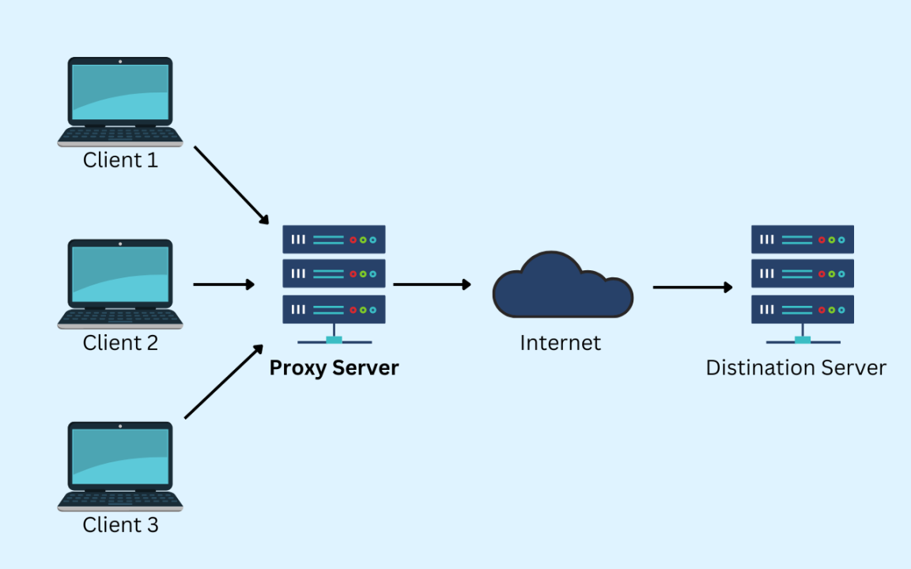
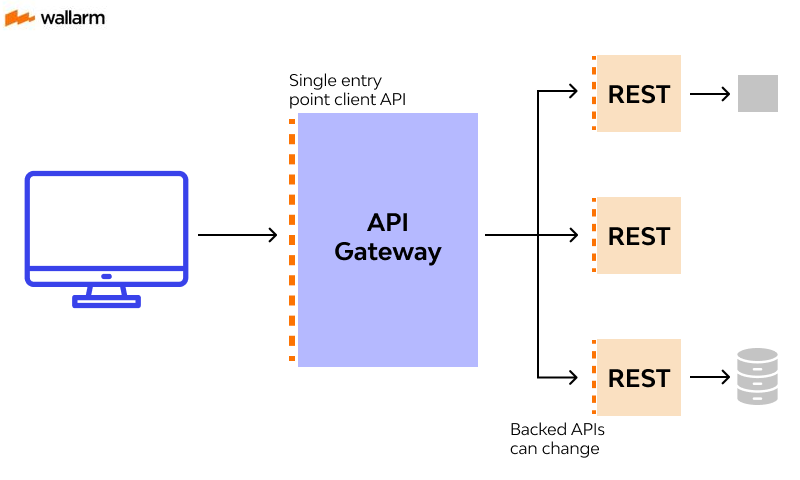
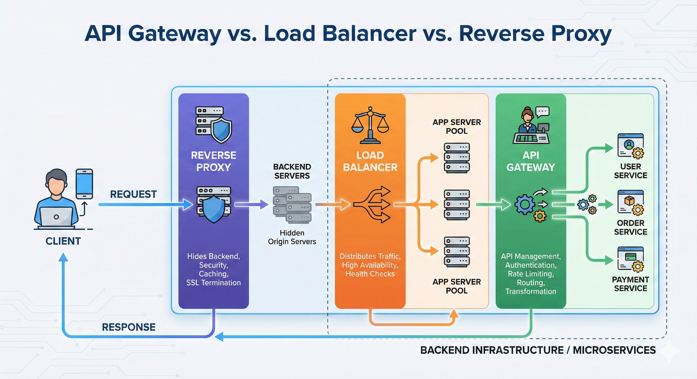

# Conceitos de Load Balancing

---

## Load Balancer

Um **load balancer** distribui requisições ou conexões entre múltiplos servidores, de acordo com critérios de distribuição e disponibilidade.



Principais responsabilidades:
- Distribuir tráfego entre instâncias.
- Evitar direcionar novas requisições para servidores indisponíveis.
- Permitir escalabilidade horizontal.
- Reduzir a sobrecarga concentrada em uma única instância.

O load balancer pode operar em diferentes camadas de rede, principalmente L4 e L7.

## L4 vs L7

A diferença está na camada do modelo de rede em que o balanceador opera e nas informações que consegue utilizar para tomar decisões.

| Característica | L4 — Transporte | L7 — Aplicação |
|---|---|---|
| Camada OSI | Transporte | Aplicação |
| Protocolos comuns | TCP, UDP | HTTP, HTTPS, gRPC |
| Informações utilizadas | IPs, portas e conexões | URLs, headers, cookies e conteúdo da requisição |
| Decisões | Baseadas na conexão | Baseadas no conteúdo da aplicação |
| Complexidade | Geralmente menor | Geralmente maior |
| Uso comum | TCP/UDP, alto volume de conexões | APIs e aplicações web |

### L4 — Layer 4

O balanceador distribui conexões considerando informações como endereço IP e porta, sem precisar interpretar o conteúdo HTTP.



É útil quando o tráfego precisa ser distribuído sem decisões baseadas no conteúdo da aplicação.

- Extremamente rápido
- Baixa latência

### L7 — Layer 7

O balanceador interpreta o protocolo da aplicação e pode direcionar requisições conforme regras de negócio de roteamento, como caminho, domínio ou headers HTTP.

```text
                 Client
                    |
                    v
              L7 Load Balancer
                 /       \
                v         v
          /api/users    /api/orders
                |         |
                v         v
           User API    Order API
```

Exemplos de regras:
- `/users` → serviço de usuários.
- `/orders` → serviço de pedidos.
- `api.exemplo.com` → API.
- `admin.exemplo.com` → aplicação administrativa.

O L7 oferece decisões mais granulares, mas exige interpretação do protocolo e pode adicionar processamento.

- Roteamento inteligente
- Segurança avançada
- Sensível ao conteúdo

---

## Reverse Proxy

Um **reverse proxy** recebe requisições dos clientes e as encaminha para servidores internos, ocultando os detalhes da infraestrutura de origem.



Responsabilidades comuns:
- Encaminhar requisições aos servidores de origem.
- Terminar conexões TLS/HTTPS.
- Aplicar regras de roteamento.
- Ocultar endereços e detalhes dos servidores internos.
- Aplicar políticas de segurança e, dependendo da solução, cache.

Um reverse proxy pode atuar também como load balancer quando distribui o tráfego entre múltiplas instâncias.

Exemplos de tecnologias: NGINX, HAProxy e Envoy.

**Diferença importante:** reverse proxy e load balancer não são sinônimos. Um reverse proxy pode encaminhar tudo para um único servidor; um load balancer tem como função distribuir tráfego entre destinos.

---

## Forward Proxy

Um **forward proxy** atua em nome dos clientes, intermediando suas conexões com servidores externos.



Responsabilidades comuns:
- Controlar o acesso à internet.
- Aplicar políticas de navegação.
- Registrar ou filtrar tráfego.
- Intermediar conexões e, em determinadas configurações, armazenar conteúdo em cache.
- Ocultar os endereços IP dos clientes perante os destinos, conforme o tipo de proxy e a configuração.

É comum em redes corporativas que precisam controlar o acesso dos dispositivos a recursos externos.

### Reverse Proxy vs Forward Proxy

| Característica | Reverse Proxy | Forward Proxy |
|---|---|---|
| Atua em nome de | Servidores | Clientes |
| Posição típica | À frente dos servidores | Entre clientes e internet |
| Objetivo | Proteger e intermediar o acesso aos serviços | Intermediar e controlar o acesso dos clientes |
| Oculta | Detalhes dos servidores internos | Identidade ou endereço dos clientes, dependendo da configuração |
| Exemplo | Entrada de uma API | Proxy de navegação corporativa |

---

## Gateway

Um **gateway** é um componente que intermedeia a comunicação entre sistemas, redes ou serviços, podendo aplicar regras de roteamento, segurança, transformação de dados e controle de acesso.

O termo é amplo: suas responsabilidades dependem do tipo de gateway.

### API Gateway

Um API Gateway centraliza a entrada para APIs e direciona as requisições aos serviços correspondentes.



Responsabilidades comuns:
- Roteamento para serviços.
- Autenticação e autorização.
- Rate limiting.
- Transformação de requisições e respostas.
- Registro e monitoramento.
- Agregação de chamadas a diferentes serviços, quando necessário.

### Gateway vs Load Balancer vs Reverse Proxy

| Componente | Responsabilidade principal |
|---|---|
| Load balancer | Distribuir tráfego entre destinos |
| Reverse proxy | Intermediar requisições destinadas a servidores |
| API Gateway | Centralizar e gerenciar o acesso às APIs |
| Forward proxy | Intermediar conexões originadas pelos clientes |

Esses papéis podem se sobrepor. Uma mesma tecnologia pode funcionar como reverse proxy, load balancer e API Gateway, dependendo de sua configuração e das funcionalidades utilizadas.

---

## Relação entre os conceitos



Esse é apenas um exemplo conceitual. Em arquiteturas reais, o load balancing pode estar integrado ao reverse proxy ou ao gateway, em vez de existir como componente separado.

A escolha depende dos requisitos de roteamento, segurança, escalabilidade, desempenho e operação.

---

<div style="display: flex; justify-content: space-between;">

[← Load Balancing](./3.0-load-balancing-concepts.md)

[Algoritmos →](./3.2-load-balancing-algorithms.md)

</div>